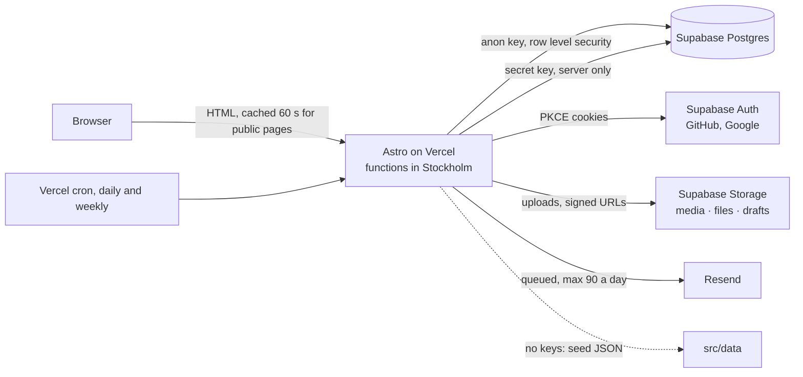

# Architecture

One Astro app, rendered on demand on Vercel, with Supabase behind it. Public pages are cached for 60 seconds (ISR); anything about a specific person is never cached.

## Request flow

1. `src/middleware.ts` runs first. On personal routes (`/me`, `/admin`, `/onboarding`, `/auth`, `/api`, `/join`) it reads the session from cookies and puts `user`, `profile` and `role` on `Astro.locals`. Public routes skip that entirely, because a cached page must never contain one person's data. On every `/api` and `/auth` mutation it checks the request came from this site.
2. Pages read data through `src/lib/content.ts`. With `PUBLIC_SUPABASE_URL` set it queries Postgres with the anon key (so row level security applies); without it, it serves `src/data/*.json`. Photos resolve through `src/lib/photos.ts` to WebP sizes in Storage or to seed images Astro optimises.
3. Writes go through API routes in `src/pages/api/` with the service key, after `requireRole` or an ownership check. They log to `audit_log`, call `bust()` to clear the in-memory memo, and ISR expiry does the rest.
4. Email goes into `email_queue`; `src/lib/email.ts` sends immediately while under the daily budget and the daily cron (`/api/cron/daily`) sends the rest by priority and keeps the free Supabase project awake. The weekly cron (`/api/cron/weekly`) queues the opt-in digest at the lowest priority for the daily run to send.

## Roles

| Role     | Who                                             | Can                                                                               |
| -------- | ----------------------------------------------- | --------------------------------------------------------------------------------- |
| guest    | anyone                                          | read public pages                                                                 |
| member   | any signed-in, onboarded account                | edit own profile, reserve spots, write and submit posts, see the group links      |
| editor   | members the admins trust with drafts            | everything a member can, plus the admin dashboard                                 |
| reviewer | blog team                                       | review queue: notes, publish, request changes                                     |
| officer  | board members                                   | events and registrations, home page content, partners, FAQ, media library         |
| admin    | the club lead and the web lead (`ADMIN_EMAILS`) | everything, plus members, roles, board, settings, flag solvers, audit log, import |

Roles are ranks: an officer can do what a reviewer can. `has_role()` in SQL and `atLeast()` in TypeScript encode the same order.

**Committees.** An admin puts a member in a committee on `/admin/members`. Each committee has a `grants_role`, and a member's effective role is the higher of their own role and their committee's (`src/middleware.ts`). Media & Marketing grants officer, so that team manages the media library, posts and events without individual role changes. Admin is only ever set per member.

## Data model

| Table                                                                                          | Holds                                                                                                            | Public read                                         | Notes                                                                                                                                                                                                                                               |
| ---------------------------------------------------------------------------------------------- | ---------------------------------------------------------------------------------------------------------------- | --------------------------------------------------- | --------------------------------------------------------------------------------------------------------------------------------------------------------------------------------------------------------------------------------------------------- |
| `profiles`                                                                                     | one row per account: name, handle, contact, major, year, links, flags                                            | only through `profiles_public` (no phone, no email) | created by a trigger on sign-up                                                                                                                                                                                                                     |
| `user_roles`                                                                                   | one role per user                                                                                                | own row                                             | first admins from `ADMIN_EMAILS`                                                                                                                                                                                                                    |
| `media`                                                                                        | every uploaded file: key, sizes, alt, bucket, post, published                                                    | published rows                                      | seed photos keep their file name as key                                                                                                                                                                                                             |
| `events`                                                                                       | title, type, start/end, location, cover, X post, registration settings                                           | published rows                                      | times are UTC instants entered in Riyadh time                                                                                                                                                                                                       |
| `registrations`                                                                                | member × event, email copy, attended (and when), show on profile, check-in token (0007)                          | own rows                                            | counts through `registration_counts()`, profile list through `profile_events()`                                                                                                                                                                     |
| `event_results` (migration 0010)                                                               | competition placings: event, place, member and/or free-text team, prize in SAR, points                           | rows of published events                            | entered on `/admin/events/<id>/results`; shown on `/timeline` and as "Wins" on profiles; a trigger awards the points once per member and event                                                                                                      |
| `posts`                                                                                        | title, HTML + JSON content, status, author, category, tags, dir, featured month (0011)                           | published rows                                      | HTML is sanitised server-side before storage; one featured post per month, set on the review page; top writers on `/blog` through `writers_leaderboard()`, named only with `show_on_leaderboard`                                                    |
| `post_reviews`                                                                                 | reviewer notes per post                                                                                          | author and reviewers                                |                                                                                                                                                                                                                                                     |
| `officer_terms`                                                                                | the board, current and past                                                                                      | all                                                 | linked to a profile when the officer has an account                                                                                                                                                                                                 |
| `committees` (migrations 0002, 0003)                                                           | who runs the club and what each committee owns, on /community; `grants_role` is the minimum role its members get | visible rows, plus a member's own committee         | ordered by `sort`; items one per line; `profiles.committee_id` points here                                                                                                                                                                          |
| `highlights`, `stories`, `strip_photos`, `impact_semesters`, `impact_items`, `partners`, `faq` | home page and FAQ content                                                                                        | visible rows                                        | ordered by `sort`                                                                                                                                                                                                                                   |
| `settings`                                                                                     | key → JSON: `site`, `links`, `home`, `banner`, `made_by` (public); `whatsapp_groups`, `email_templates` (admins) | public keys only                                    | a trigger refuses invite links under any public key                                                                                                                                                                                                 |
| `flag_solvers`                                                                                 | names from the hidden challenge                                                                                  | approved rows                                       | moderated in admin                                                                                                                                                                                                                                  |
| `points` (migrations 0005, 0006)                                                               | one row per award: member, amount, category, reason, event or post, automatic or by whom                         | own rows; officers all                              | never a running total; automatic awards are triggers on `registrations`, `posts`, `flag_solvers` and `event_results`; public totals through `member_points()` and `leaderboard()`; names on `/leaderboard` only with `profiles.show_on_leaderboard` |
| `badges`, `member_badges` (migration 0014)                                                     | the badge catalogue; one row per badge a member holds: badge, date, reference, automatic or by whom              | catalogue: all; awards: own rows, officers all      | First post, 5 events and Flag solver are triggers on `posts`, `registrations`, `events`, `flag_solvers`; officers award the rest on `/admin/badges`; public via `profile_badges()` only with `profiles.show_badges` (default off)                   |
| `email_queue`, `audit_log`, `rate_limits`, `keepalive`, `digest_runs` (0009)                   | operations; `digest_runs` holds one row per weekly digest, which stops a second run in the same week             | none                                                | service key only; the digest goes to members with `profiles.digest_opt_in`                                                                                                                                                                          |

Everything is in `supabase/migrations/0001_init.sql`, commented. New tables go in new migration files.

## Security in one paragraph

Row level security is on everywhere, and user tokens have read policies only: a member's token can read their own rows and published content, nothing more, and cannot write any table. Every write goes through the API with the service key after a role or ownership check, so validation and sanitising cannot be skipped by calling PostgREST directly. Draft uploads sit in a private bucket and are served through `/api/media/<key>` with short-lived signed URLs until the post is published. Public forms are rate limited by a Postgres function the API alone can call. The service key never leaves the server; `.env` is ignored by git.

## Client side

Small modules in `src/scripts/`, each initialised through `src/scripts/page.js` so they survive Astro's client-side page transitions. TipTap loads only on the editor page. No client framework.
